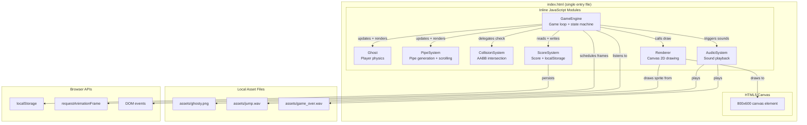
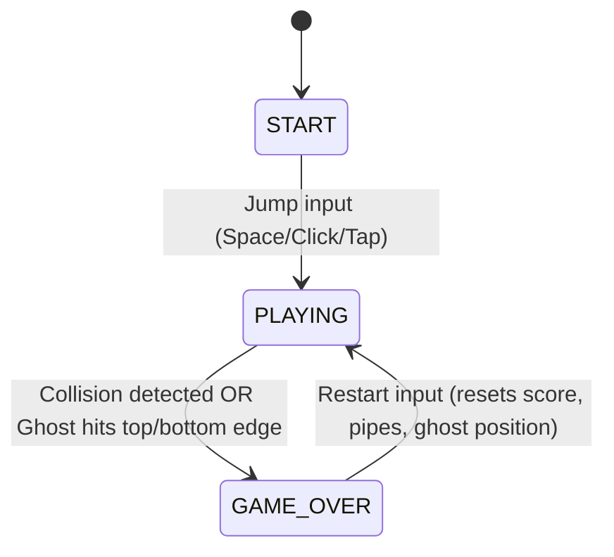
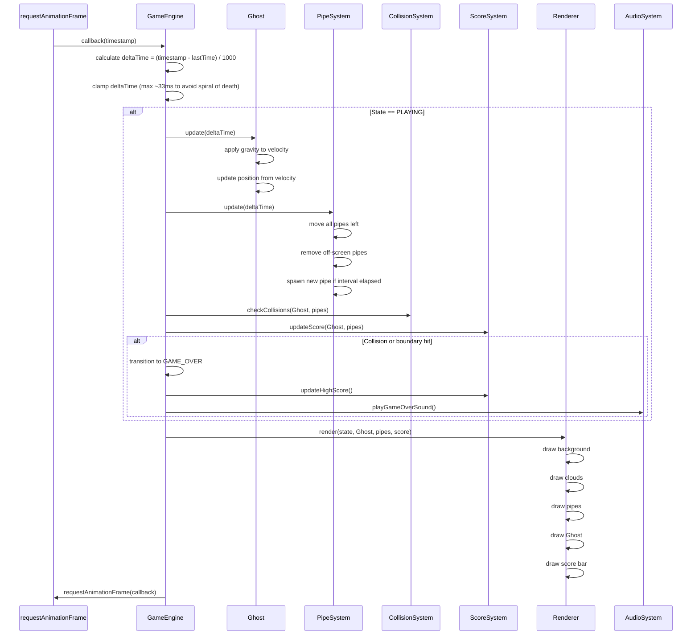

# Design Document: Flappy Kiro

## Overview

Flappy Kiro is a browser-based endless scroller game inspired by Flappy Bird. The player controls a ghost character that navigates through gaps between green pipes by timing jumps. The game features a retro/sketch aesthetic with a blue background, decorative clouds, and a score display. It runs entirely in the browser using vanilla JavaScript and the HTML5 Canvas API, requiring no external dependencies or build tools.

### Key Design Decisions

- **Single-file architecture**: All JavaScript is embedded inline in `index.html` to guarantee the game runs by opening one file in any modern browser via `file://` protocol. ES6 `import`/`export` is avoided because it requires a server and breaks `file://` compatibility.
- **Class-based modules**: Each subsystem (GameEngine, Ghost, PipeSystem, CollisionSystem, ScoreSystem, AudioSystem, Renderer) is implemented as a JavaScript class within the inline script. Classes are organized in dependency order: lower-level modules (Ghost, PipeSystem) are defined first, then higher-level modules (GameEngine) that compose them.
- **Delta-time game loop**: The main loop uses `requestAnimationFrame` with delta-time calculation so pipe speed (120 px/s) and gravity are frame-rate independent. A fixed physics timestep is not used; instead, physics values are expressed in units per second and multiplied by delta time.
- **AABB collision**: All collision detection uses axis-aligned bounding boxes. The Ghost and each pipe segment are represented as rectangles, and intersection is checked via the standard separating-axis overlap test.
- **State machine**: Three explicit game states (START, PLAYING, GAME_OVER) drive all input handling, rendering, and update logic. Transitions are guarded by the current state.
- **localStorage persistence**: The high score is read on load and written on game-over when a new record is set. The key is `"flappyKiroHighScore"`.

## Architecture



### Module Dependency Order

Modules are defined in the following order within the inline script to satisfy JavaScript's class hoisting and dependency requirements:

1. **Configuration constants** — canvas dimensions, physics values, pipe parameters
2. **AudioSystem** — wraps `Audio` objects, handles load failures
3. **ScoreSystem** — manages score state and localStorage persistence
4. **Ghost** — player entity with position, velocity, and bounding box
5. **PipeSystem** — generates and scrolls pipe pairs, manages lifecycle
6. **CollisionSystem** — pure AABB intersection functions
7. **Renderer** — all Canvas 2D drawing operations
8. **GameEngine** — top-level coordinator that composes all modules, runs the game loop, and manages the state machine

### State Machine



### Game Loop

The game loop runs via `requestAnimationFrame` and follows this sequence each frame:



## Components and Interfaces

### GameEngine

The central coordinator. Owns instances of all subsystems, runs the game loop, manages state transitions, and routes input.

```javascript
class GameEngine {
  constructor(canvas, assets)
  start()          // begins the game loop, initializes to START state
  handleInput()    // routes input based on current state
  update(dt)       // delegates updates to Ghost, PipeSystem, ScoreSystem when PLAYING
  render()         // delegates to Renderer
  transitionTo(newState)  // state machine transition with side effects
  reset()          // resets score, pipes, ghost to initial state for restart
}
```

**Key behaviors:**
- On `handleInput` in START state: transition to PLAYING, apply jump impulse to Ghost.
- On `handleInput` in GAME_OVER state: call `reset()`, transition to PLAYING, apply jump impulse.
- On `handleInput` in PLAYING state: apply jump impulse to Ghost, play jump sound.
- Stores `lastTime` for delta-time calculation, clamped to a maximum to prevent large time jumps after tab switches.

### Ghost

The player-controlled character with physics.

```javascript
class Ghost {
  constructor(x, y, width, height)
  reset()           // returns to initial position and velocity
  applyJump()       // sets upward velocity impulse
  update(dt)        // applies gravity, updates position
  getBoundingBox()  // returns {x, y, width, height} for collision
}
```

**Physics constants:**
- `GRAVITY`: 900 px/s² (downward acceleration)
- `JUMP_IMPULSE`: -350 px/s (upward velocity set on jump)
- Initial position: x=400 (horizontal center), y=300 (50% canvas height)
- Bounding box: 40×40 px (derived from ghost sprite proportions)

### PipeSystem

Manages the lifecycle of pipe pairs: generation, movement, and removal.

```javascript
class PipeSystem {
  constructor(canvasWidth, canvasHeight)
  update(dt)                        // moves pipes, removes off-screen, spawns new
  getActivePipes()                  // returns array of active PipePair objects
  reset()                           // clears all pipes
  spawnPipePair()                   // creates new PipePair at right edge
}
```

**Pipe generation parameters:**
- Spawn interval: 1.5 seconds
- Pipe body width: 60 px
- Pipe cap width: 68 px (8 px wider than body, centered)
- Pipe cap height: 20 px
- Gap size: 150 px (fixed)
- Gap center Y: random between 75 and 225 px from top
- Scroll speed: 120 px/s (leftward)
- Spawn position: x = canvas width (800), so pipe enters from the right edge

### CollisionSystem

Pure functions for axis-aligned bounding box intersection. No internal state.

```javascript
class CollisionSystem {
  static aabbIntersect(boxA, boxB)          // returns boolean
  static checkGhostPipes(ghostBox, pipes)   // returns boolean (true if any collision)
  static checkBoundaries(ghostBox, canvas)  // returns 'top', 'bottom', or null
}
```

### ScoreSystem

Manages current score, high score, and localStorage persistence.

```javascript
class ScoreSystem {
  constructor()
  reset()                    // sets current score to 0
  getCurrentScore()          // returns current score
  getHighScore()            // returns stored high score
  checkPipePassed(ghost, pipePair)  // returns true if ghost passed pipe center (first time)
  updateHighScore()         // compares current to high, updates if greater, persists
  loadHighScore()           // reads from localStorage, defaults to 0 if invalid
}
```

**localStorage details:**
- Key: `"flappyKiroHighScore"`
- Value: integer (the high score)
- On load: parse as integer; if `NaN` or negative, default to 0
- On game over: if `currentScore > highScore`, set `highScore = currentScore` and write to localStorage

### AudioSystem

Wraps `HTMLAudioElement` objects and handles playback failures gracefully.

```javascript
class AudioSystem {
  constructor(jumpSrc, gameOverSrc)
  playJump()           // plays jump sound
  playGameOver()       // plays game over sound
  // Audio failures are caught and silently ignored
}
```

**Error handling:**
- Each `play()` call is wrapped in try/catch
- If the audio element isn't loaded or the browser blocks autoplay, the game continues without interruption
- The `currentTime` is reset to 0 before each play to allow rapid re-triggering

### Renderer

All Canvas 2D drawing operations. Stateless beyond the canvas context reference.

```javascript
class Renderer {
  constructor(ctx, canvasWidth, canvasHeight, ghostImage)
  render(state, ghost, pipes, currentScore, highScore)
  drawBackground()
  drawClouds()
  drawPipePair(pipePair)
  drawGhost(ghost)
  drawScoreBar(currentScore, highScore)
  drawStartScreen()
  drawGameOverScreen()
}
```

**Rendering z-order (back to front):**
1. Blue background (full canvas fill)
2. White clouds (fixed positions)
3. Pipes (green body + green cap)
4. Ghost sprite
5. Score bar (dark bar at bottom with "Score: X | High: Y")

## Data Models

### Game States

```javascript
const GameState = {
  START: 'START',
  PLAYING: 'PLAYING',
  GAME_OVER: 'GAME_OVER'
};
```

### Ghost Model

```javascript
Ghost {
  x: number          // horizontal position (fixed at 400)
  y: number          // vertical position (starts at 300)
  velocityY: number  // vertical velocity (px/s)
  width: number       // bounding box width (40)
  height: number      // bounding box height (40)
}
```

### PipePair Model

```javascript
PipePair {
  x: number           // left edge x-position (starts at canvas width)
  gapCenterY: number  // vertical center of the gap (75-225 range)
  gapSize: number      // fixed at 150
  width: number        // pipe body width (60)
  capWidth: number     // pipe cap width (68)
  capHeight: number    // pipe cap height (20)
  scored: boolean      // whether ghost has passed this pipe's center (for scoring)
}
```

### Configuration Constants

```javascript
const CONFIG = {
  CANVAS_WIDTH: 800,
  CANVAS_HEIGHT: 600,
  GHOST: {
    X: 400,
    Y: 300,
    WIDTH: 40,
    HEIGHT: 40
  },
  PHYSICS: {
    GRAVITY: 900,        // px/s²
    JUMP_IMPULSE: -350,  // px/s
    MAX_FALL_SPEED: 700  // terminal velocity (px/s)
  },
  PIPES: {
    WIDTH: 60,
    CAP_WIDTH: 68,
    CAP_HEIGHT: 20,
    GAP_SIZE: 150,
    GAP_MIN_Y: 75,
    GAP_MAX_Y: 225,
    SPEED: 120,           // px/s
    SPAWN_INTERVAL: 1.5   // seconds
  },
  STORAGE_KEY: 'flappyKiroHighScore',
  CLOUDS: [
    { x: 100, y: 80, size: 40 },
    { x: 500, y: 120, size: 30 },
    { x: 300, y: 200, size: 25 }
  ]
};
```

## Correctness Properties

*A property is a characteristic or behavior that should hold true across all valid executions of a system — essentially, a formal statement about what the system should do. Properties serve as the bridge between human-readable specifications and machine-verifiable correctness guarantees.*

### Property 1: Jump impulse resets velocity

*For any* current velocity, when a jump action is triggered, the Ghost's vertical velocity SHALL be set to exactly `JUMP_IMPULSE`, regardless of the prior velocity value.

**Validates: Requirements 2.1**

### Property 2: Gravity uniformly accelerates

*For any* velocity `v` and time delta `dt`, applying gravity produces a new velocity `v' = v + GRAVITY * dt`. The velocity change depends only on `dt`, not on the current velocity.

**Validates: Requirements 2.2**

### Property 3: Position update follows velocity

*For any* position `y`, velocity `v`, and time delta `dt`, the updated position is `y' = y + v * dt`. The position change is proportional to both velocity and elapsed time.

**Validates: Requirements 2.3**

### Property 4: Boundary detection correctness

*For any* Ghost position, the boundary check returns `'top'` if the Ghost's bounding box top edge is at or above `y=0`, returns `'bottom'` if the bottom edge is at or below `y=600`, and returns `null` otherwise. A position exactly at the boundary is treated as a violation.

**Validates: Requirements 2.4, 4.3, 4.4**

### Property 5: Pipe gap bounds invariant

*For any* generated PipePair, the gap center Y is within `[75, 225]` pixels from the top of the canvas, and the gap size is exactly `150` pixels. This holds across all random generations.

**Validates: Requirements 3.2**

### Property 6: Pipe movement and lifecycle

*For any* PipePair with left-edge position `x` and time delta `dt`, after one update the new position is `x' = x - SPEED * dt` (where `SPEED = 120`). When `x' + width < 0`, the PipePair is removed from the active list. New PipePairs are spawned at the right edge when `spawnTimer >= SPAWN_INTERVAL` (1.5s).

**Validates: Requirements 3.1, 3.3, 3.4**

### Property 7: Pipe dimensions invariant

*For any* PipePair, the body width is `60` pixels, the cap width is `68` pixels (wider than the body), and the cap height is `20` pixels. The cap is positioned at the gap-facing end of each pipe segment.

**Validates: Requirements 3.5**

### Property 8: AABB collision correctness

*For any* Ghost bounding box and any set of pipe bounding boxes, the collision check returns `true` if and only if the Ghost's box overlaps with at least one pipe's box. Two boxes overlap if and only if they intersect on both the x-axis and y-axis simultaneously. The check covers all pipes visible within the canvas boundaries.

**Validates: Requirements 4.1, 4.2**

### Property 9: Score increment on pipe pass

*For any* unscored PipePair, when the Ghost's horizontal position reaches or exceeds the PipePair's center (`ghost.x >= pipe.x + pipe.width / 2`), the current score increments by exactly `1` and the PipePair is marked as scored. Each PipePair increments the score at most once.

**Validates: Requirements 5.1**

### Property 10: High score is the maximum

*For any* current score `c` and stored high score `h`, after calling `updateHighScore()`, the new high score is `max(c, h)`. The high score never decreases.

**Validates: Requirements 5.3**

### Property 11: High score load validation

*For any* value stored in localStorage under the key `"flappyKiroHighScore"`, the loaded high score is the parsed integer if it is a valid non-negative integer, or `0` if the value is missing, `NaN`, negative, or non-numeric.

**Validates: Requirements 5.5**

### Property 12: Audio failure resilience

*For any* game state, if `AudioSystem.play()` throws an error (due to missing assets, browser restrictions, or other failures), the GameEngine catches the error and continues operating without interruption. The game state, score, and physics are unaffected by audio failures.

**Validates: Requirements 6.3**

### Property 13: Game over reset invariant

*For any* game in the GAME_OVER state with arbitrary score and pipe configurations, after a restart action: the current score is `0`, the active pipe list is empty, the Ghost is at its initial position `(400, 300)` with zero velocity, and the game state is `PLAYING`.

**Validates: Requirements 7.4**

### Property 14: Aspect ratio preservation on resize

*For any* browser viewport dimensions, when the canvas is scaled to fit the available space, the rendered aspect ratio remains `800:600` (4:3). The canvas is scaled using CSS (width/height style properties) while the internal resolution stays at `800x600`.

**Validates: Requirements 9.3**

## Error Handling

### Asset Loading Failures

If any asset (ghosty.png, jump.wav, game_over.wav) fails to load:
- The GameEngine displays an error message on the canvas (e.g., "Failed to load game assets. Please refresh the page.")
- Initialization halts — no game loop starts
- The error message replaces the START screen

### Audio Playback Failures

If `HTMLAudioElement.play()` fails (browser autoplay policy, missing file, decode error):
- The error is caught in a try/catch block within `AudioSystem.play*()` methods
- The game continues without interruption — no state change, no crash
- No error message is shown to the user (silent failure by design, per requirement 6.3)

### localStorage Failures

If localStorage is unavailable (private browsing, quota exceeded, disabled):
- `ScoreSystem.loadHighScore()` catches the error and defaults to high score `0`
- `ScoreSystem.updateHighScore()` catches the error and keeps the in-memory high score (persistence is best-effort)
- The game functions normally; only cross-session persistence is affected

### Delta Time Clamping

If the browser tab is backgrounded and `requestAnimationFrame` pauses:
- On resume, the delta time could be very large (seconds or minutes)
- The GameEngine clamps delta time to a maximum of `~33ms` (approximately 2 frames at 60fps) to prevent physics tunneling (Ghost moving through pipes in a single frame)
- This prevents the "spiral of death" where large delta times cause increasingly slow updates

### Invalid localStorage Values

If the stored high score is not a valid non-negative integer:
- `NaN`, `undefined`, `null`, negative numbers, and non-numeric strings all result in a default high score of `0`
- The invalid value is not overwritten until a new valid high score is achieved through gameplay

## Testing Strategy

### Dual Testing Approach

The game uses both property-based tests and example-based/integration tests:

**Property-based tests** validate universal properties of the game logic across many randomly generated inputs. These cover the physics engine, collision detection, pipe generation, scoring, and state management.

**Unit tests** verify specific examples, edge cases, and rendering behavior that are not suitable for property-based testing (UI rendering, asset loading, audio playback).

**Integration tests** verify side-effect operations involving browser APIs (localStorage, Audio, Canvas) using mocks.

### Property-Based Test Configuration

- **Library**: `fast-check` (JavaScript property-based testing library)
- **Iterations**: Minimum 100 per property test
- **Test file**: `test/flappy-kiro.test.js` (runs with Node.js + a test runner like Vitest or Jest)
- **Tagging**: Each property test includes a comment: `// Feature: flappy-kiro, Property N: <description>`
- **Mocking**: DOM APIs (Canvas, localStorage, Audio) are mocked for pure logic tests

### Unit Test Coverage

Unit tests (example-based) cover:
- Asset loading success and failure scenarios (smoke tests)
- START state rendering (ghost position, instructions, background)
- Score bar format string: `"Score: X | High: Y"`
- Canvas initialization: 800x600 dimensions
- Z-order rendering sequence (background → clouds → pipes → ghost → score bar)
- Pipe rendering: green body + green cap, cap wider than body
- Cloud rendering: fixed positions, white color

### Integration Test Coverage

Integration tests (with mocks) cover:
- localStorage read/write for high score persistence
- Audio playback triggered on jump and game over events
- Audio failure does not crash the game
- Full game cycle: START → PLAYING → GAME_OVER → PLAYING (restart)

### Test File Structure

```
workshop-kiro/
├── index.html              # Game entry file (inline JS)
├── assets/
│   ├── ghosty.png
│   ├── jump.wav
│   └── game_over.wav
├── test/
│   ├── flappy-kiro.test.js # Property + unit + integration tests
│   └── setup.js            # Mock setup for Canvas, localStorage, Audio
└── package.json            # Dev dependencies only (fast-check, test runner)
```

### Property Test Details

Each property test follows this pattern:

```javascript
// Feature: flappy-kiro, Property 1: Jump impulse resets velocity
fc.assert(fc.property(fc.float({ min: -1000, max: 1000 }), (initialVelocity) => {
  const ghost = new Ghost(400, 300, 40, 40);
  ghost.velocityY = initialVelocity;
  ghost.applyJump();
  return ghost.velocityY === CONFIG.PHYSICS.JUMP_IMPULSE;
}), { numRuns: 100 });
```

### Non-PBT Testing Areas

The following acceptance criteria are tested with example-based or smoke tests rather than property-based tests:

| Criterion | Type | Reason |
|-----------|------|--------|
| 1.1 Asset loading | SMOKE | One-time setup, no input variation |
| 1.2 Asset failure | EDGE_CASE | Specific error scenario |
| 1.3 START screen | EXAMPLE | Specific UI rendering |
| 1.4 Canvas init | SMOKE | Fixed configuration |
| 5.2 Score bar format | EXAMPLE | Specific string format |
| 5.4 localStorage write | INTEGRATION | Side-effect, I/O operation |
| 6.1 Jump sound | INTEGRATION | Side-effect, audio I/O |
| 6.2 Game over sound | INTEGRATION | Side-effect, audio I/O |
| 7.1 State init | SMOKE | Fixed initial state |
| 7.2 START→PLAYING | EXAMPLE | Single transition rule |
| 8.1-8.6 Rendering | EXAMPLE | Visual output verification |
| 9.1 No external libs | SMOKE | Architecture constraint |
| 9.2 Single HTML file | SMOKE | Architecture constraint |
