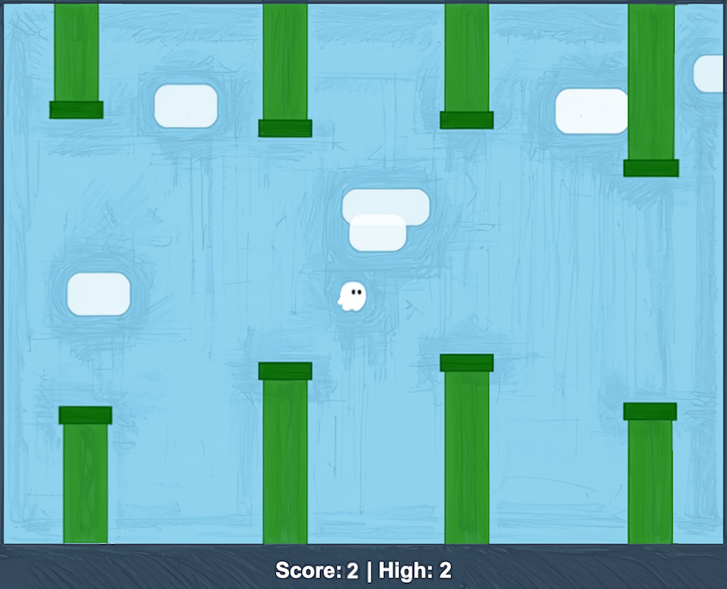

# Flappy Kiro — Kiro Express Workshop

Construiremos un clon de Flappy Bird (con el fantasma de Kiro) usando **specs de Kiro**.
Los documentos de especificación ya están generados: tú solo tienes que **ejecutar las tareas**.

## Prerrequisitos

- [Kiro IDE](https://kiro.dev) instalado y con sesión iniciada
- Node.js **20.19+** o **22.12+** (`node -v`)
- Un navegador moderno

## Paso a paso

1. Abre esta carpeta en Kiro (`File > Open Folder`, la carpeta que contiene `.kiro/`).
2. En el selector de modelo del chat elige el modelo indicado por el instructor.
3. Abre el panel **Specs** y selecciona `flappy-kiro`. Lee `requirements.md` y `design.md` (no los modifiques).
4. Abre `tasks.md`. **Empieza en la tarea 1.1** y ejecuta las tareas **en orden** con *Start task*.
5. Salta las tareas marcadas con `*` (son tests opcionales).
6. Después de la tarea 1.1, si Kiro no instaló las dependencias, ejecuta `npm install` en la terminal.
7. Cuando termines, abre `index.html` en el navegador (doble clic) y juega con **Espacio**, click o tap.

## Estructura

| Ruta | Descripción |
|---|---|
| `.kiro/specs/flappy-kiro/` | Spec: requisitos, diseño y tareas (ya escritos) |
| `assets/` | Sprite del fantasma y sonidos |
| `index.html` | El juego (lo crea Kiro al ejecutar las tareas) |
| `package.json`, `test/` | Infraestructura de tests (la crea Kiro en la tarea 1) |

## Si algo sale mal

- `npm test` debe terminar sin errores en los checkpoints (tareas 9, 13 y 15).
- Si te quedas sin créditos, avisa al instructor: hay una versión de referencia.

## Licencia

Ver `LICENCE.md`.
